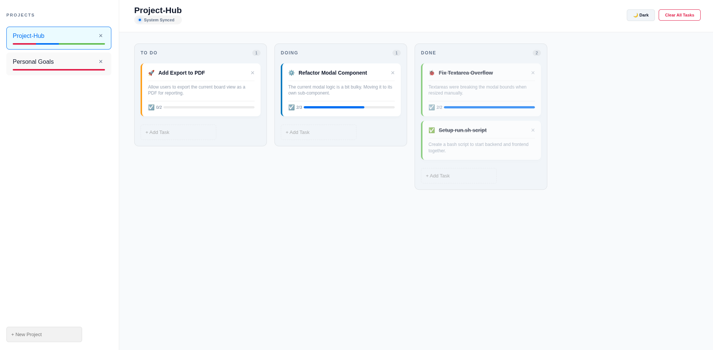
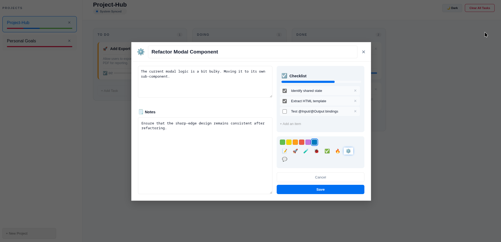

# Project-Hub

A high-performance, minimalist **Kanban Task Management** application built with a focus on developer productivity. 



---

## 🚀 Key Features

* **Fluid Kanban Interface:** Effortless task management across customizable status columns (To Do, Doing, Done).
* **Refined Task Detail Modal:** Optimized 60/40 split layout with a "Sharp-Edge" IDE-inspired design.
* **Reactive Checklists:** Real-time sub-task tracking with automated progress calculation and persistent state.

### 📸 Visual Preview

#### Task Detail Workspace
The detail popup is designed for deep work, featuring integrated category icons, color coding, and an expanded notes area.



---

## 🛠️ Technical Stack

* **Client:** Angular — `src/client`
* **Server:** FastAPI / Python 3 — `src/server` (port 9998 by default)
* **Data Persistence:** Pydantic-validated JSON storage (`data/projects.json`) with in-memory caching.

## 📁 Project Structure

```
src/
  server/    FastAPI backend (API + serves the built client)
  client/    Angular frontend
dist/        Angular build output, served by the server (generated)
data/        projects.json / projects_archived.json / auth.json (generated)
examples/    project_hub_client.py — example API client (device login)
build.sh     Creates .venv, installs deps, builds the client into dist/
run.sh       Runs the server (API + built client) on port 9998
run-dev.sh   Runs the server + Angular dev server (port 4200)
```

## 📦 Installation & Setup

```bash
git clone https://github.com/tugapse/project-hub.git
cd project-hub
./build.sh
cd src && ../.venv/bin/python -m server create-user   # creates the login account
```

## 🖥️ Usage

**Production-style (single process):**
```bash
./run.sh
```
Open http://localhost:9998.

**Development (hot reload):**
```bash
./run-dev.sh
```
Open http://localhost:4200 (API on 9998).

## 🔐 Authentication

The app has a single user, created on the server with `python -m server create-user` (run from `src/`, with the venv). The browser signs in with that account (session cookie, valid for 30 days).

**API access from code** uses a Bearer token obtained via a *device flow* (like `gh auth login`):

```bash
python examples/project_hub_client.py login      # prints a URL + code; approve it in the browser
python examples/project_hub_client.py projects   # uses the saved token (~/.config/project-hub/token)
```

Any HTTP client can then call the API:

```bash
curl -H "Authorization: Bearer $(cat ~/.config/project-hub/token)" http://localhost:9998/api/projects
```

Manage tokens on the server (takes effect without a restart):

```bash
cd src
../.venv/bin/python -m server tokens list
../.venv/bin/python -m server tokens revoke <id>
```

**Environment variables:**
* `PROJECT_HUB_HOST` (default `0.0.0.0`)
* `PROJECT_HUB_PORT` (default `9998`)
* `PROJECT_HUB_JSON_FILE` (default `<repo>/data/projects.json`)
* `PROJECT_HUB_AUTH_FILE` (default `<repo>/data/auth.json`): user and token hashes
* `PROJECT_HUB_PUBLIC_URL`: public client URL used in device-login links (e.g. `https://example.com/hub/`); defaults to the URL the request came in on
* `PROJECT_HUB_COOKIE_SECURE` (default `0`): set to `1` when served over HTTPS

**To stop:** Press Ctrl+C. The scripts trap the signal and free the ports.

---
*Created as part of a personal tooling and learning.*
*Maintained by Fabio Almeida.*
